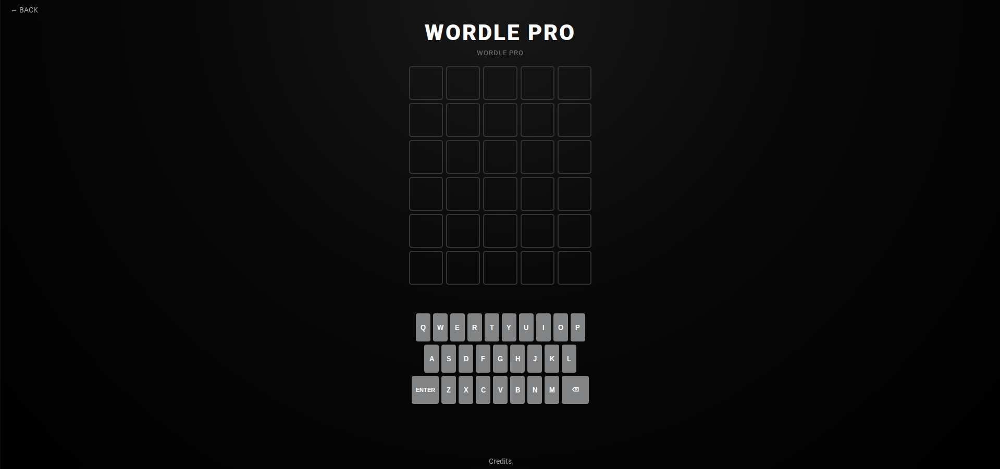

# 🟩 WordlePro

**Wordle, but Pro.** A browser-based word-guessing game built with plain HTML, CSS, and JavaScript.

**▶ Play it:** `https://lebrongoat2323.github.io/WordlePro/`.


<!-- TODO: add a screenshot or GIF of a game in progress as screenshot.png -->

---

## How to play

1. Guess the hidden word.
2. After each guess, the tiles change color to show how close you were:
   - 🟩 **Green** – right letter, right spot
   - 🟨 **Yellow** – right letter, wrong spot
   - ⬛ **Gray** – letter is not in the word
3. Use the clues to find the word before you run out of guesses.

<!-- TODO: confirm the number of guesses and word length in your version -->

## What makes it "Pro"

<!-- TODO: this is the most important section. List what you added beyond regular Wordle. Examples: -->
- Unlimited Games
- Over 5757 Possible Words
- Premium Dark Style

## Run it locally

```bash
git clone https://github.com/LEBRONGOAT2323/WordlePro.git
cd WordlePro
```

Then open `index.html` in any modern browser. There is nothing to install.

## Tech stack

- HTML, CSS, and vanilla JavaScript
- Single-file project (`index.html`)
- Hosted on GitHub Pages

## How it works

<!-- TODO: write 2-4 sentences. For example: where the word list comes from, how a guess is checked against the answer (including how repeated letters are handled), and how the keyboard colors update. -->

## Roadmap

- Different Word Lengths
- Themes

---

Built by [LEBRONGOAT2323](https://github.com/LEBRONGOAT2323).
